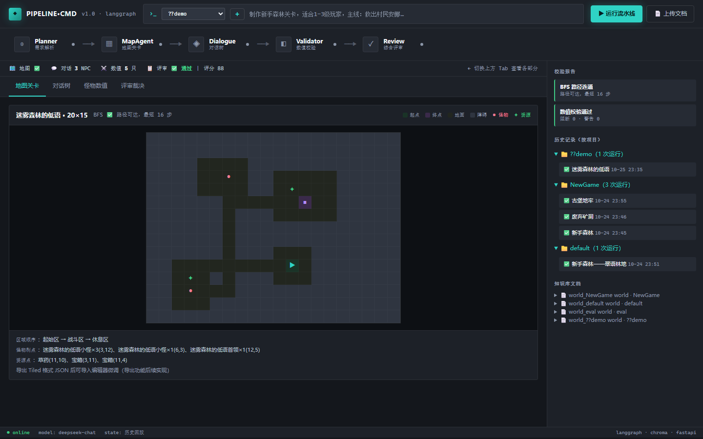
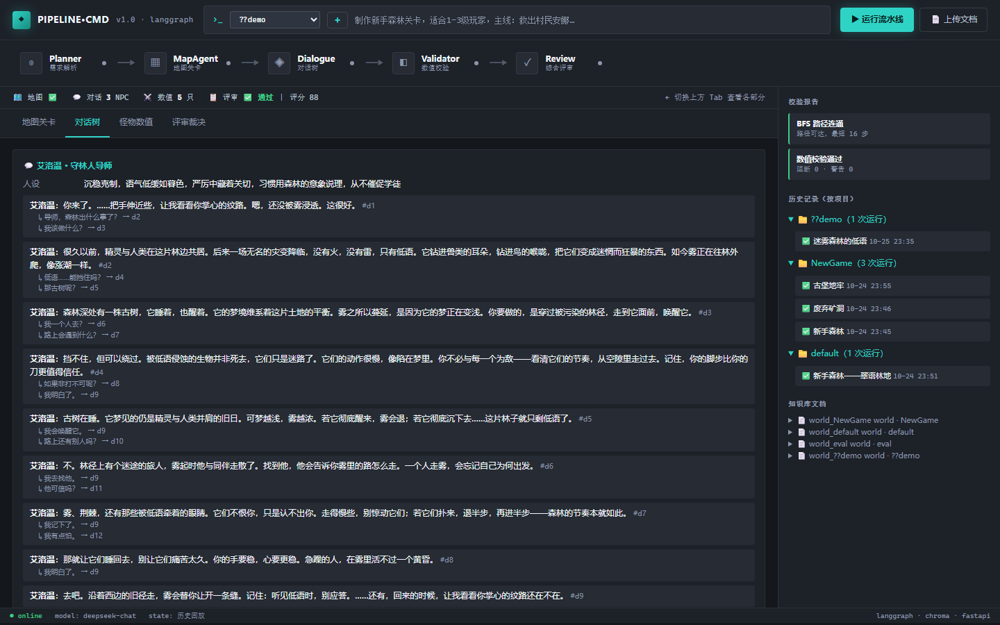
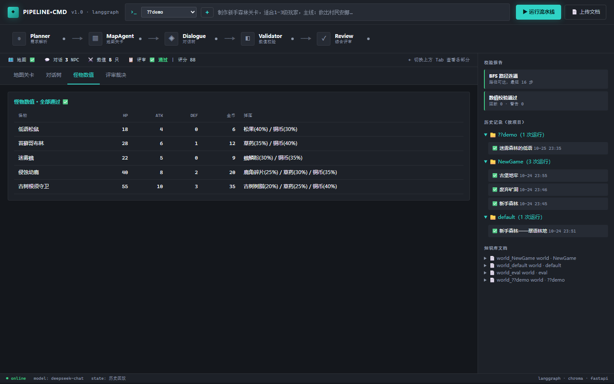
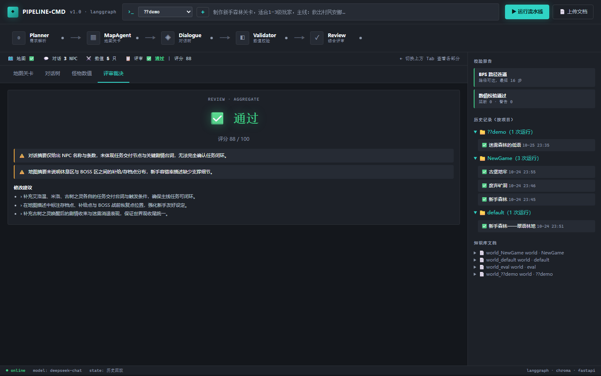

# PIPELINE·CMD — 游戏关卡 & 剧情策划辅助多智能体系统

> 面向独立游戏团队的 AI 策划流水线：输入自然语言需求，自动产出世界观、Tiled 兼容地图、NPC 对话树、怪物数值，经确定性校验与综合评审后归档，支持历史回放。



## 核心特性

- **5 个 Agent 分工协作**：Planner（规划）/ Map（地图）/ Dialogue（对话）/ Validator（数值）/ Review（评审），LangGraph 状态机编排
- **工具调用（Function Calling）**：MapAgent 调用确定性地图生成器，LLM 只决策参数（尺寸/主题/难度），代码保证连通性
- **确定性校验优先**：BFS 路径校验 + 数值硬规则（负值/秒杀/爆率溢出/金币超限），不依赖 LLM，防幻觉
- **RAG 防设定冲突**：支持上传本地世界观文档；Planner 生成前检索历史设定，生成后沉淀新设定
- **多项目隔离**：同一游戏的多条需求共享世界观，不同游戏互不干扰
- **历史归档与回放**：每次运行的完整产出存档，点击历史记录即可回放所有 Tab
- **可量化**：数值规则准确率 100%，BFS 路径准确率 100%

## 界面

| 对话树 | 怪物数值 |
|---|---|
|  |  |

| 评审裁决 |
|---|
|  |

## 架构

```
用户需求（自然语言）
   ↓
PlannerAgent ── 解析需求、生成世界观、拆解任务
   ↓
MapAgent ── Function Calling → generate_pixel_map（确定性生成，BFS 保证连通）
DialogueAgent ── 生成 NPC 分支对话树
   ↓
NumericValidatorAgent ── LLM 出数值 + 硬规则校验（负值/秒杀/爆率/金币）
   ↓
ReviewAgent ── 综合评审（剧情/世界观/数值）
   ├─ 通过 → 归档 + 保存完整产出
   └─ 驳回 → 带意见回 Planner 迭代（最多 3 轮，防死循环）

RAG：上传文档 / 自动沉淀的世界观 → Chroma → Planner 生成前检索（防冲突）
```

## 快速开始

### 1. 环境
Python 3.10+（推荐 3.12）

### 2. 安装
```bash
pip install -r requirements.txt
```

### 3. 配置
复制 `.env.example` 为 `.env`，填写 LLM Key：
```
LLM_API_KEY=sk-xxx
LLM_BASE_URL=https://api.deepseek.com
LLM_MODEL=deepseek-chat
```

### 4. 启动
```bash
python -m uvicorn app.api.main:app --host 127.0.0.1 --port 8600
```
打开 http://127.0.0.1:8600

### 5. 使用
1. 下拉选择项目，或点 `+` 新建
2. 输入策划需求 → 点「运行流水线」
3. 在地图/对话/数值/评审 Tab 查看产出
4. 点「上传文档」可导入本地世界观（`.md/.txt/.json`），参与检索
5. 点右侧历史记录可回放任意一次运行

## 评测结果

| 评测组 | 用例数 | 结果 |
|---|---|---|
| A. 数值规则校验（确定性） | 12 | **准确率 100%** |
| B. BFS 路径校验（确定性） | 10 | **准确率 100%** |
| C. 端到端流水线（LLM） | 3 | BFS 通过率 100% · 评审通过率 67% |

详见 [reports/eval_report.md](reports/eval_report.md)

## 项目结构

```
game-agent/
├── app/
│   ├── api/main.py           # FastAPI 后端
│   ├── agents/               # 5 个 Agent（planner/map/dialogue/validator/review）
│   ├── tools/                # 确定性工具（BFS 路径/数值规则/像素地图生成）
│   ├── rag/                  # RAG（知识库/文档导入/轻量 embedding）
│   ├── graph.py              # LangGraph 状态机编排
│   ├── llm.py                # LLM 封装（JSON 强约束 + 失败重试）
│   └── state.py              # 全局 State 定义
├── web/frontend/index.html   # PIPELINE·CMD 前端（深色战术终端风格）
├── scripts/                  # 测试与评测脚本
├── docs/screenshots/         # 界面截图
├── reports/eval_report.md    # 评测报告
├── data/lore/                # 可导入的示例世界观文档
├── requirements.txt
└── .env.example
```

## 技术栈

- **Agent 编排**：LangGraph（状态机 + 条件边 + 循环控制）
- **LLM**：DeepSeek（OpenAI 兼容；可换通义千问 / Ollama 本地模型）
- **向量库**：Chroma（轻量哈希 embedding，零依赖离线可用，可无缝换 BGE/OpenAI）
- **后端**：FastAPI
- **前端**：原生 HTML/CSS/JS（无框架，加载快）

## 设计要点（面试可讲）

1. **LLM 决策 + 代码保证质量**：地图不由 LLM 直接画网格，而是 Function Calling 调用确定性生成器，LLM 只决定尺寸/主题，代码保证连通
2. **确定性校验优先**：BFS 路径校验、数值硬规则用 Python 写死，不依赖 LLM——大模型会说谎，算法不会
3. **评审兜底**：地图不可达或数值阻断时强制驳回，不信任 LLM 的"通过"
4. **多项目隔离**：知识库按 project 过滤，run 记录不参与检索，避免自我污染
5. **完整归档**：每次运行存完整产出（payload），支持历史回放
